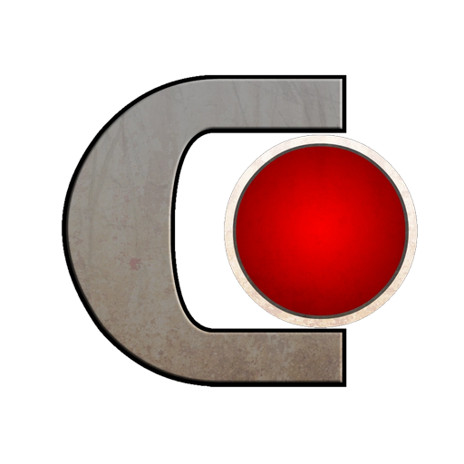

  

<h1 align="center">Concordance Developers</h1>

  <b>Разработка выделенного сервера Dead Space на базе Space Station 14</b> 
  Основано в 2026 году

  <a href="https://github.com/concordance-dev/dead-space-14">Репозиторий ассетов</a> • 
  <a href="https://github.com/concordance-dev/dead-space-14/discussions">Обсуждения</a>

---

### О проекте

Concordance Developers — независимое объединение, созданное в 2026 году с целью разработки отдельного игрового сервера по вселенной **Dead Space** на базе **Space Station 14** (ремейка классической Space Station 13).

Наша задача — перенести гнетущую атмосферу научно-фантастического хоррора оригинальной трилогии Dead Space в формат глубокого ролевого отыгрыша:
* Выживание на борту огромного корабля-потрошителя USG Ishimura и в шахтёрских комплексах колонии Aegis VII.
* Механика расчленения некроморфов (отсечение конечностей как главный способ борьбы).
* Модульные костюмы RIG с индикатором здоровья на спине, стазисом, кинезисом и защитой от вакуума.
* Психологическое давление и галлюцинации от воздействия Обелиска на экипаж.

### Текущее состояние

На данный момент полностью собрана и стандартизирована техническая база ресурсов:
* Свыше 600 пакетов спрайтов в формате RSI (Robust State Image), разложенных по 10 каталогам: костюмы, оружие, стены, двери, механизмы, некроморфы, эффекты биомассы и интерфейс. Вся графика извлечена и переработана из открытых наработок сообщества Dead Space 13 (DS13-2.0 / Baystation12).
* Более 1 000 звуковых файлов: выстрелы, шаги, крики монстров, звуки корабельных систем и русская озвучка бортового компьютера Ишимуры от студий GamesVoice, R.G. MVO, CGInfo и официального дубляжа EA.

### Как помочь проекту

У проекта нет спонсоров, инвесторов или платной поддержки. Вся разработка держится на энтузиазме.

Мы ищем единомышленников, готовых помочь на добровольной основе:
* **Программисты (C# / RobustToolbox):** перенос и написание игровых механик (стазис, кинезис, расчленение, костюмы).
* **Мапперы:** сборка палуб Ишимуры и секторов колонии в редакторе карт SS14.
* **Спрайтеры:** создание недостающих спрайтов, анимаций и оверлеев.

Если у вас уже есть своя команда в сообществе Space Station 14 — вы можете свободно брать наши подготовленные ресурсы и использовать их в своих сборках в рамках лицензий AGPLv3 и CC-BY-SA 3.0.

Присоединяйтесь к общению и разработке в разделе [Discussions](https://github.com/concordance-dev/dead-space-14/discussions).
